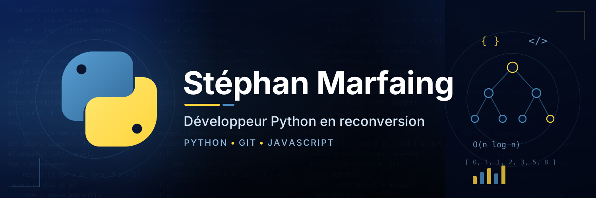

# Bonjour, je suis Stéphan 👋

🎓 En formation Développeur d'Application Python chez OpenClassrooms

Après plus de 10 ans d'expérience dans le domaine de la biologie médicale et du management en santé, je me forme aujourd'hui au développement d'applications Python avec OpenClassrooms. Cette reconversion me permet de combiner mes compétences analytiques, ma rigueur professionnelle et ma passion pour la programmation.

## 🛠️ Compétences techniques

**Concepts :** Programmation orientée objet (POO) • Algorithmes et optimisation • Analyse des besoins • Architecture logicielle • Bases de données

## 🚀 Projets principaux

### ♟️ Gestionnaire de tournoi d'échecs

📂 [Repository GitHub](https://github.com/stephanmarfaing/oc-p4-chess-tournament)

Application permettant de gérer des tournois d'échecs, les joueurs, les rounds et les matchs.

**Compétences :** Programmation orientée objet • Architecture logicielle Python • Modélisation des données • TinyDB • Interface en ligne de commande • Bonnes pratiques de développement

### 🌐 Application Web interactive

📂 [Repository GitHub](https://github.com/stephanmarfaing/oc-p6-front-end-app)

Développement et amélioration d'une interface web dynamique dans le cadre de la formation OpenClassrooms.

**Compétences :** HTML5 • CSS3 • JavaScript • Manipulation du DOM • Responsive Design • Accessibilité web • Optimisation de l'expérience utilisateur

### 📈 Optimisation d'un portefeuille d'investissement

📂 [Repository GitHub](https://github.com/stephanmarfaing/oc-p7-optimisation-investissement)

Implémentation et comparaison de différentes approches algorithmiques afin de déterminer la combinaison d'actions la plus rentable sous contrainte budgétaire.

**Compétences :** Python • Algorithme de force brute • Algorithme glouton • Programmation dynamique • Analyse de complexité • Optimisation des performances

## 👤 Mon parcours

- Plus de 10 ans d'expérience en laboratoire de biologie médicale
- Cadre de santé
- Développeur Python en formation chez OpenClassrooms

Cette expérience professionnelle m'a permis de développer des compétences transférables essentielles : rigueur, autonomie, travail en équipe, gestion des priorités et résolution de problèmes complexes.

## 🎯 Objectif professionnel

À l'issue de ma formation, je souhaite rejoindre une équipe de développement en tant que développeur Python junior afin de mettre en pratique mes compétences techniques et poursuivre ma montée en compétences dans le développement logiciel.

## 📚 En cours d'apprentissage

## 📫 Contact

Merci de votre visite !
